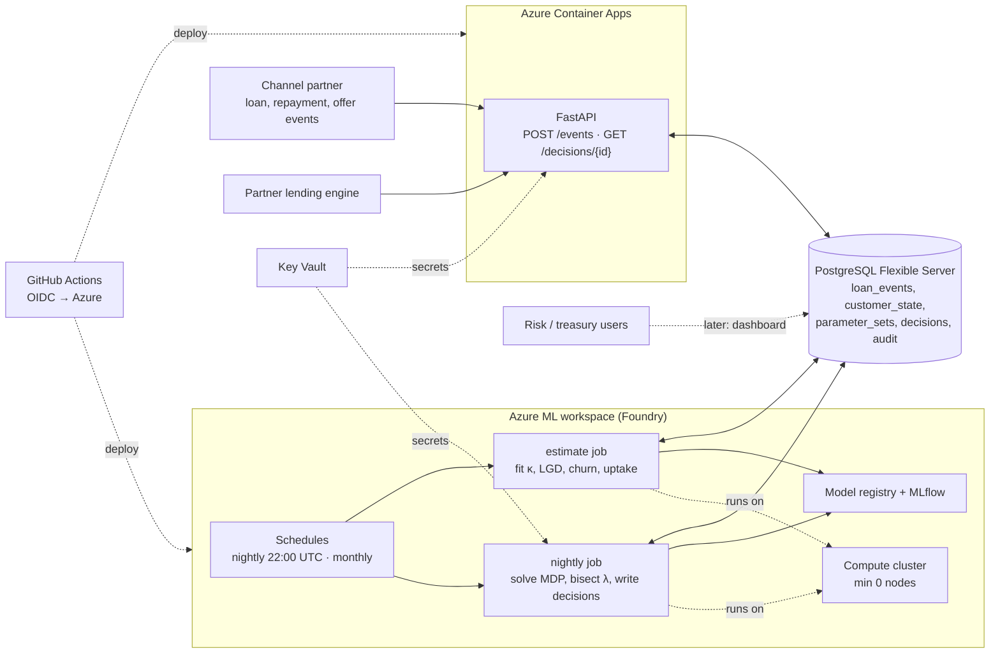
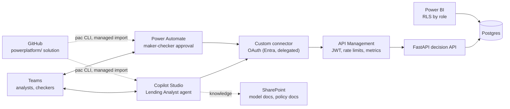

# Architecture: DigitalLendingML on Azure

Nightly batch solves the MDP for every customer, writes versioned decisions to Postgres, a small API serves them.

## Organisation and scale

Built for **Ruskins Digital Lending Ltd** (fictional), a Kenyan digital microlender. Design targets (working assumptions):

| Dimension | Target | Design consequence |
|---|---|---|
| Active borrowers | up to **1M per week** | |
| Customer book | **3–5M** customers | Nightly solve and simulation run in **chunks** (customers are independent at a fixed λ; capital is additive), never the whole book in memory |
| Loan events | ~5M per week (disburse, repay/miss, offer, accept/decline) ≈ 8/s average, ~100/s at peaks (month end, mornings) | Idempotent ingest; `loan_events` partitioned by month; old partitions archived to Parquet in storage |
| Decision lookups | ~1M per week ≈ 2/s average, ~50/s peak | Primary-key read of precomputed rows; one small container handles it |
| Nightly batch | 3–5M customers, finished by 04:00 Nairobi | Chunked solve on the ML cluster; Monte Carlo validation on a sample, full runs weekly |
| Database | Dev: B1ms. Prod: General Purpose (D-series) with HA and read replica for the dashboard | Sized from measured load, not guessed |

Model assumptions and the reference data are unchanged; they are replaced by estimates once logged outcomes exist.

## Components

| Component | Service | Why this one |
|---|---|---|
| Model jobs (train, validate, nightly solve, monthly estimate) | Azure ML command / pipeline jobs on a compute cluster with `min_instances: 0` | Pay per run only. MLflow tracking and the model registry are built in, which links code, parameter and data versions. |
| Scheduling | Azure ML schedules (cron, UTC) | Lives next to the jobs; no extra service. |
| Database | PostgreSQL Flexible Server (Burstable B1ms to start) | Schema in `db/migrations/`. Plain Postgres, so no lock-in. |
| Decision API + ingest | One FastAPI app on Container Apps (consumption, scale to zero) | Reads precomputed rows, so it is small. One service until ingest load justifies splitting it out. |
| Secrets / identity | Key Vault + user-assigned managed identity | API and jobs reach Postgres and storage without stored passwords. |
| IaC | Bicep (`infra/main.bicep`) | Native, no state file to manage. |
| CI/CD | GitHub Actions, OIDC federated credential | No long-lived Azure secret in GitHub. |
| Dashboard | Power BI (Phase 2, step 6) | Replaces a custom Next.js dashboard. One dashboard, not two. |

Why not an Azure ML **online endpoint** for the API: it is an always-on VM, billed 24/7, to serve rows from a table. The model runs in batch; the API only reads.

## Nightly run

1. Load `active` parameter set and current `customer_state`.
2. Pre-flight checks: volumes, bucket mix shift, parameter bounds. Fail ⇒ do not publish.
3. Vectorised backward induction per batch of customers; bisect λ to the capital budget.
4. Write `decisions` for this `run_id` (with `param_version`, `model_version` = git SHA, reason codes, Q-values).
5. Atomic publish: flip the active-run pointer in one transaction. API keeps serving the previous run on failure.
6. Log metrics (offers, expected NPV, capital used, λ*) to MLflow.

Champion/challenger: arm assigned by hash of `customer_id` (stable), 80/20.

## CI/CD

| On | Runs |
|---|---|
| Pull request | ruff, mypy, `pytest tests/unit`, data contract tests, model gates on synthetic data |
| Merge to `main` | Build API image → ACR → Container Apps revision; register Azure ML environment + job definitions; apply DB migrations |
| Policy release | Shadow → challenger 20% → promote by switching active parameter/model version (config change, no redeploy) |

## Environments

Start with one (`dev`) resource group. Add `prod` when there is something worth protecting.

## Estimated monthly cost (dev, idle most of the time)

| Item | Approx. |
|---|---|
| Postgres Flexible B1ms + 32 GB | ~$15–20 |
| Azure ML workspace (storage, Key Vault, App Insights, ACR Basic) | ~$5–10 |
| Compute cluster (scale to zero; a nightly run is minutes on a small CPU node) | ~$1–5 |
| Container Apps consumption (scale to zero) | ~$0 within free grant |

Verify against the Azure pricing calculator before provisioning.

## Dev network posture (stopgap)

Dev Postgres has public access with **Entra-only authentication** (no passwords) and the "allow Azure services" firewall rule. That is a **dev stopgap**. Production fix: VNet-integrated Container Apps environment, Postgres with private access (delegated subnet) or a private endpoint, Azure ML managed VNet, Key Vault and storage behind private endpoints, public network access disabled.

## Decided

- Region: `southafricanorth`.
- Resource group `rg-digitallending-dev`; resources named `<type>-digitallending-dev` (globally unique ones get a suffix). See `infra/main.bicep`.

## Open decisions

- Whether to enable the nightly schedule in dev, or trigger runs manually.

---

# Phase 2: Microsoft business layer

Each item serves a real need of the lending system: approvals, explanations, API security, the dashboard. **Prerequisite: Phase 1 decision API is live.** Documentation only until each step is approved.

Order: **2.1 Entra → 2.2 approvals → 2.3 ALM → 2.4 Copilot agent → 2.5 APIM → 2.6 Power BI.** Entra comes first because the custom connector and the approval flow authenticate through it.

| Step | What | Detail |
|---|---|---|
| 2.1 Entra | App registration for the API with an API scope (`Decisions.Read`, `Parameters.Propose`, `Parameters.Approve`); one for the custom connector (delegated OAuth). Jobs keep managed identities. | Least privilege; an ownership table of every identity and credential in `docs/identities.md`. |
| 2.2 Approvals | Analyst proposes a parameter set → Teams adaptive-card approval to a checker (who cannot be the maker) → on approve, connector calls the API to flip `parameter_sets.status`, with an audit row. | Input validation, retries/timeouts, failure branch notifying the analyst. Nightly-run failures also post to Teams. |
| 2.3 ALM | One solution, `DigitalLendingOps`: unmanaged in dev, exported/unpacked with `pac` into `powerplatform/`, imported **managed** into test/prod by GitHub Actions (`microsoft/powerplatform-actions`). | Environment variables: API base URL, SharePoint site. Connection references: Teams, Approvals, custom connector. Post-import smoke flow; rollback = re-import previous managed version. |
| 2.4 Copilot agent | "Lending Analyst" in Teams: "why was customer X held?", "how much capital is left?" (connector actions on `GET /decisions` + reason codes); "what does γ mean?" (grounded in the model documentation in SharePoint, permission-aware). | **Read-only.** Any change goes through 2.2. Eval set in `copilot/evals/` (groundedness, refusal on unsupported questions, latency, cost per answer). Later option: a Foundry agent with AI Search that Copilot Studio calls. |
| 2.5 APIM | Consumption tier in front of the decision API (and any Foundry model endpoint). | Entra JWT validation, rate/token limits (AI gateway policies), per-consumer metrics to App Insights. Azure Monitor alerts: failed nightly job, failed flows, API 5xx. |
| 2.6 Power BI | Portfolio report: offers, NPV, capital vs budget, λ*, PSI drift, champion vs challenger. | Row-level security by role. Replaces the Next.js dashboard. |

## Phase 2 cost and licensing (verify each before relying on it)

| Item | Expected |
|---|---|
| Power Apps / Automate Developer Plan | Free developer environment with Dataverse and premium connectors |
| Copilot Studio | Trial; check length and whether Teams publishing is covered |
| M365 Copilot | ~$30/user/month; optional, not on the critical path |
| Power BI | Desktop free; publishing/sharing needs Pro or PPU |
| APIM Consumption | Pay per call; check free grant |

## Phase 2 open decisions

- Which M365 tenant hosts Teams/SharePoint/Power Platform (an Azure-only tenant has no M365 licences; a Microsoft 365 Developer Program tenant is the usual route).
- Copilot Studio licensing route.
- Power BI connectivity to Postgres: direct with gateway vs scheduled export.
