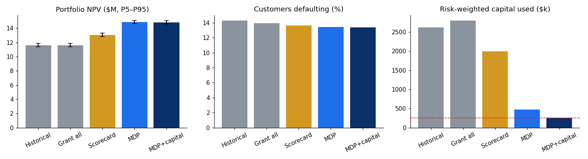
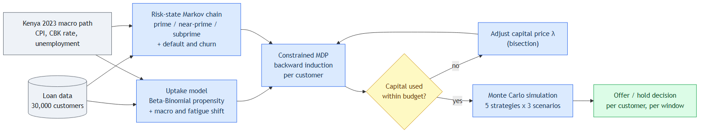
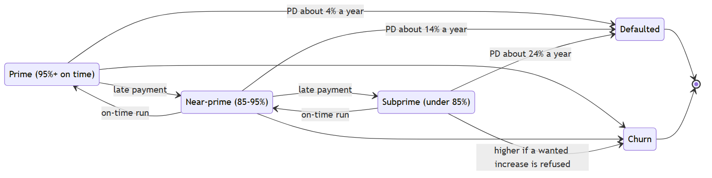
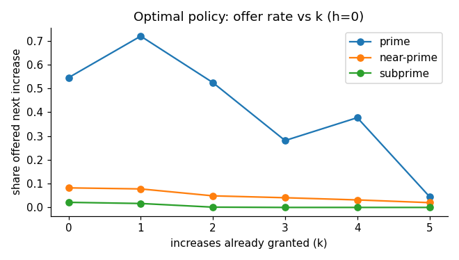
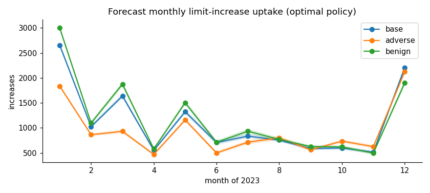
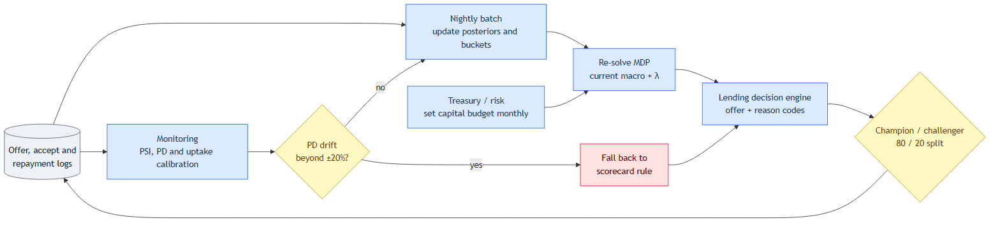

# Loan Limit Increase Optimisation: 2023 Book

> The research behind this repository, published as a teaching case. It was run on a 30,000-customer loan book for 2023; the code in this repository reproduces the method on synthetic data, so its numbers (for example λ*) differ from the ones below. Parameters and their status: [assumptions.md](assumptions.md). Each technique is explained step by step in the [study notes](study/README.md).

## Problem statement

A digital lender wants to use loan limit increases to raise customer retention, lifetime value and profitability without taking on excessive default risk. The task is to design a model that decides the best limit increase policy for its customer base in 2023, under realistic constraints and stochastic borrower behaviour, using operations research, machine learning or a hybrid of the two.

What the model has to account for:

- **Dynamic credit eligibility:** borrowers move between risk categories (prime, near-prime, subprime) according to their repayment record.
- **Markov chain modelling:** transitions between risk states.
- **Stochastic demand forecasting:** how many customers take up an offered increase.
- **Loan lifecycle simulation:** borrowing and default over several periods.
- **Constrained optimisation:** regulatory and capital-efficiency limits must hold.

Given terms:

- A customer becomes eligible for an increase 60 days after the previous loan was disbursed, provided repayments are on time.
- Each increase extends the borrowing term by a variable number of days that depends on the customer.
- A customer can receive at most 6 increases a year; whether to grant each one is a decision for the model.
- After accepting an increase a customer may repay early, on time, or default, with some probability distribution.
- Each increase earns an additional $40 of profit, against which default risk must be weighed.
- Cash flows are discounted at 19% a year for NPV.
- Total exposure must stay within a risk-weighted capital limit.
- Inflation, unemployment and interest rates should feed into the demand forecast.
- Any further assumption must be stated with its rationale.

The data is 30,000 customer records with loan amount, days since the last loan, on-time repayment rate, number of increases received in 2023 and profit contribution. The analysis is expected to forecast uptake, optimise the policy under the constraints, measure risk with probabilistic models (MDP, Monte Carlo, credit scoring) and simulate the loan lifecycle.

Five questions frame the results:

1. What is the optimal limit increase strategy, balancing profit and risk?
2. Which operations research techniques model the problem best?
3. How does borrower behaviour (repayment, churn, acceptance) change the optimal strategy?
4. How do external economic conditions change it?
5. What else (reinforcement learning, dynamic pricing, behavioural nudges) could raise profit and lower defaults?

## Summary

The problem is treated as a sequential decision. At every 60-day eligibility window the question is whether to offer a customer another increase, given their risk, the size of their loan, how likely they are to accept, and how much capital the portfolio has left. It is modelled as a Markov decision process over risk states, solved for every customer, with a single shadow price on capital keeping the whole portfolio within budget. The resulting policy is tested in a Monte Carlo simulation of the 2023 lifecycle.

Headline results (base macro case, 100 simulated paths):

| Strategy | NPV mean | NPV P5–P95 | Increases | Default rate | Churn | Risk-weighted capital |
|---|---|---|---|---|---|---|
| Historical 2023 (as observed) | $11.61M | 11.37–11.87M | 61,874 | 14.3% | 10.3% | $2.61M |
| Grant whenever eligible | $11.63M | 11.37–11.88M | 66,158 | 14.0% | 10.0% | $2.80M |
| Scorecard rule (prime and near-prime only) | $13.07M | 12.82–13.32M | 52,173 | 13.6% | 13.2% | $1.99M |
| Optimal policy, no capital limit | $14.89M | 14.66–15.10M | 20,405 | 13.5% | 20.9% | $0.48M |
| Optimal policy with capital limit | $14.84M | 14.59–15.06M | 13,401 | 13.4% | 22.6% | $0.25M |

The constrained policy raises NPV by about $3.2M (28%) over what happened in 2023. It uses 78% fewer increases, needs a tenth of the risk-weighted capital, and slightly lowers the default rate. The price is higher churn, discussed under Q3. Churn is the most important number to test before relying on the result.

## 1. What the data does and does not tell us

The file has 30,000 clean rows: no missing values and unique customer IDs. Several features of it shape the approach.

- The features look synthetic. Loan size, days since last loan and on-time percentage are each roughly uniform and essentially uncorrelated with one another and with the number of increases (all |r| < 0.01).
- Customers received either 0 or 3–5 increases in 2023, never 1, 2 or 6. Five is a natural ceiling: six back-to-back 60-day cycles already take 360 days, so any term extension pushes a sixth increase into the next year.
- The profit column is 40 × (n − 2), not 40 × n as the problem statement gives. One reading is $40 per increase less a fixed $80 programme cost per participating customer. The base case uses the stated $40 per increase; the data's version is tested as a sensitivity.
- There are no repayment outcomes, no history of risk states and no record of offers made or declined. Default behaviour, bucket migration and acceptance therefore have to come from models with stated assumptions, and sensitivity analysis shows which of those assumptions matter.
- The 2023 increases bear no relationship to risk. Subprime customers received as many increases as prime ones.

Before building anything structural, the features were checked for any power to predict uptake. A logistic regression and a LightGBM model both score a cross-validated AUC of about 0.50, so no feature-based uptake model was built. Each customer's revealed behaviour (their 2023 count) is used as the signal instead.

## 2. Approach

### Risk states

Customers are placed in three buckets by on-time rate: prime (95% and above), near-prime (85–95%) and subprime (below 85%). Default and churn are absorbing states. Each customer has an underlying repayment reliability, represented as a Beta distribution centred on their on-time rate and worth about 20 past loans of evidence. After each loan the outcome updates that distribution and the customer is re-bucketed. Simulating one cycle across the book gives the transition matrices for "hold" and "grant". Granting moves the matrix slightly towards the worse buckets, because a larger limit carries more repayment strain.

Under these assumptions the implied annual default rates are about 3.8% for prime, 14.1% for near-prime and 23.6% for subprime.

### Uptake

Each customer's propensity to accept is estimated as (n + 1) / 7, the Beta-Binomial posterior mean if they had about five offers in 2023 and accepted n of them. At decision time that propensity is shifted on the log-odds scale for the macro environment and for fatigue (each increase already taken makes the next one a little less likely). Each offer is then accepted or declined at random, so demand is stochastic. The monthly uptake forecast in section 4 comes from simulating it.

### Optimisation model

The state is (r, k, h): the risk bucket, the number of increases granted so far, and the number of windows passed without one. Because the timing is fixed by the eligibility rule, the date follows from the state: t = w + 60(k + h) + E·k, where w is the wait to the first window and E is the customer's term extension. At each window there are two actions, offer or hold.

The per-cycle default probability is p(r, k, t) = κ · ℓ(r) · (1 + γk) · M(t), where ℓ(r) is the bucket's late-payment rate, γ is the leverage effect of each increase and M(t) is the macro multiplier. Writing δ(d) = 1.19−d/365 for the discount factor over d days:

- Hold: δ(60) · [ (1 − p)·m·L₀ − p·LGD·Lk + (1 − p)(1 − c₀ − cd·a)·E V(r′, k, h + 1) ]
- Offer: a · δ(60 + E) · [ (1 − p′)(m·L₀ + f) − p′·LGD·Lk+1 + (1 − p′)(1 − c₀)·E V(r′, k + 1, h) ] + (1 − a) · Hold without the refusal penalty

where a is the acceptance probability, f is the $40 fee net of early-repayment rebates, m is the base margin, c₀ is baseline churn and cd is the extra churn when a customer who wanted an increase is refused. V is the larger of the two. After 31 December the customer is valued by six more cycles of expected margin less expected loss, which stops the model from treating year-end as the end of the relationship.

The portfolio problem is

  maximise Σᵢ E[NPVi]  subject to  Σᵢ E[K(r)·(Li,k − Li,0)] ≤ C

with capital weights K of 8%, 12% and 20% by bucket and a budget C of $250k. Capital is the only thing linking customers, so the constraint is relaxed with a Lagrange multiplier λ. Each customer's problem then becomes an independent MDP in which any extra exposure still held at year end is charged λ·K(r) per dollar. All 30,000 are solved at once by vectorised backward induction, and bisection finds the smallest λ whose policy keeps average capital within the budget, measured on the same simulated paths used to report results: λ* ≈ 0.62. On those paths the constrained policy uses $249,999 of the $250,000 budget. This is the weakly coupled MDP decomposition described by Hawkins (2003) and Adelman and Mersereau (2008). Its cost grows linearly with the number of customers, so it carries over to a book of millions.

### Simulation

The policy is checked in a simulator that is deliberately more detailed than the model the optimiser sees. Each path draws a customer-specific true reliability and stochastic repayment outcomes (early, on time, late or default). It also draws acceptance, term extensions (Poisson around the customer's mean), churn and Bayesian re-bucketing. Five strategies are compared under three macro scenarios. If the optimised policy still wins here, the bucket-level simplifications in the optimiser are not what drives the result.

## 3. Assumptions

The data is silent on most of the economics, so these values are set by judgement for unsecured digital credit in Kenya, not estimated. Section 5 shows how much each one moves the answer.

| Item | Value used | Why |
|---|---|---|
| Late payments that roll to default (κ) | 25% | Gives annual default rates of roughly 4% / 14% / 24% by bucket |
| Loss given default | 65% | Unsecured mobile credit, weak recoveries |
| Leverage effect (γ) | default risk rises 10% per increase | Over-indebtedness |
| Size of each increase | 15% of the initial loan | A common step size |
| Base margin | 4% of the initial loan per repaid 60-day cycle | Fees less funding and operating costs; needed to value retention |
| Fee per increase | $40, earned when the loan is repaid | Problem statement |
| Early repayment | 30% of on-time payers repay early and earn 80% of the fee | Interest rebate |
| Term extension | 10 to 30 days, longer for bigger loans | Larger loans take longer to repay |
| First eligibility | max(0, 60 − days since last loan), counted from 1 January 2023 | The 60-day eligibility rule |
| Churn | 2% per cycle, plus 6% if a wanted increase is refused | Saying no has a retention cost |
| Capital | weights 8% / 12% / 20%, budget $250k | Riskier exposure uses more capital; budget chosen so the limit binds |
| Discounting | 19% a year | Problem statement |
| Macro path (Kenya, 2023) | Monthly CPI inflation from 9.0% (January) to 6.6% (December); CBK rate 8.75%, raised to 9.50% (March), 10.50% (June) and 12.50% (December); unemployment held at 5.7% | CPI: KNBS (2023), Table 1. CBK rate: CBK Monetary Policy Committee decisions (2023). Unemployment is an assumed baseline: no verified 2023 figure was available. It only affects the scenarios, because it stays flat in the base case |
| Macro effects | higher rates and unemployment raise default risk; inflation raises demand and rates lower it | The default link is consistent with 2023: the banking-sector NPL ratio rose from 13.9% to 15.6% as the CBK rate rose (CBK, Bank Supervision Annual Report 2023). The sizes of all macro effects are illustrative, set for the scenario tests in Q4; estimating them needs several years of default and uptake data |

One more assumption needs flagging. Each customer's 2023 increase count is used both to estimate their uptake and to evaluate the 2023 policy, so this is a retrospective replay of 2023. In production, uptake would be estimated from the previous period.

## 4. Answers to the five questions

### Q1. What is the optimal strategy?

Offer an increase only when the expected fee and the value of keeping the customer outweigh the expected extra loss and the cost of the capital it ties up. In practice the policy comes out as follows (share of customers offered at their first window):

| Bucket | Loan up to $1.5k | $1.5k–2.5k | $2.5k–3.5k | Above $3.5k |
|---|---|---|---|---|
| Prime | 100% | 90% | 45% | 8% |
| Near-prime | 36% | 0% | 0% | 0% |
| Subprime | 10% | 0% | 0% | 0% |

Loan size matters as much as the risk bucket. A $40 fee cannot cover the loss from even a small rise in the chance of defaulting on a large balance. Offers also become rarer as increases accumulate, because each one adds leverage and lowers the chance the next is accepted.

### Q2. Which operations research techniques fit best?

A finite-horizon MDP over Markov risk states is the recommended core model. The problem is genuinely sequential, the state space per customer is small enough to solve exactly, and each decision can be explained by its state. Lagrangian decomposition handles the portfolio capital limit without coupling 30,000 problems together, and Monte Carlo simulation is the honest way to evaluate the policy. Two alternatives were considered. An integer program over pre-set annual plans would lose the ability to react as customers move between buckets. Genetic algorithms or reinforcement learning would give no optimality guarantee and need far more data than this file contains.

### Q3. How does borrower behaviour change the strategy?

- **Churn after a refusal** matters most. With no extra churn from refusals, NPV rises by $1.45M and the policy grants fewer increases. Doubling it to 12% lowers NPV by $0.80M, and the policy responds by granting more. The optimised policy accepts noticeably higher churn than the 2023 policy (22.6% against 10.3%) in exchange for lower losses. That trade-off rests on the churn assumption, so measuring how customers actually react to a refusal is the first thing to test.
- **Acceptance propensity** focuses offers on customers likely to take them, since an unwanted offer has no upside.
- **Repayment behaviour** works through bucket migration: a customer can earn their way into eligibility, or lose it, during the year.

### Q4. How do economic conditions affect it?

| Scenario | NPV mean | Increases | Default rate | Capital price λ |
|---|---|---|---|---|
| Base (2023 path) | $14.79M | 13,402 | 13.4% | 0.62 |
| Adverse (CPI +4pp, CBK rate +3pp, unemployment +2pp) | $8.26M | 11,325 | 19.8% | 0 |
| Benign (CPI −2pp, CBK rate −2pp, unemployment −1pp) | $17.67M | 14,120 | 10.7% | 0.91 |
| Base policy run in the adverse world | $8.25M | 13,303 | 19.9% | — |

In a downturn the policy tightens by itself, and the capital limit stops binding. In good conditions capital becomes the bottleneck, which shows up as a higher λ, so extra capital is worth more then. The policy optimised for the base case lost only about 0.1% when run in the adverse world, compared with a policy re-optimised for it. This suggests the policy rules can stay stable while the capital budget follows the macro outlook.

The monthly forecast is driven mostly by eligibility timing rather than by the economy. Most customers are already eligible on 1 January, so uptake comes in 60-day waves (January, March, May and so on) that flatten as term extensions spread customers out. The adverse scenario sits below the others in the first half of the year, when the policy is most selective. The December spike is most likely an artefact of the one-year horizon: customers who have been held all year reach a final window on about day 360. At that point the fee and the retention benefit are counted in full, but the risk beyond 2023 is only approximated by the terminal value. A rolling twelve-month horizon in production removes the year-end edge.

### Q5. What else could raise profit and lower defaults?

- **Behavioural nudges.** An incentive for early or on-time repayment, such as M-Pesa cashback or an on-time streak that unlocks the next step, was the biggest controllable gain tested. A 15% fall in late payments rolling to default added about $1.79M.
- **Smaller, more frequent steps.** 10% increases did better than 15%, and 25% did worse.
- **Learning uptake and churn directly.** A contextual bandit or Thompson sampling on offer timing and size would replace the assumed effects with measured ones.
- **Risk-based pricing.** Pricing the increase fee by bucket, rather than simply refusing most near-prime customers.
- **Reinforcement learning on logged data.** This becomes worthwhile once a few cycles of offers and outcomes have been recorded. The MDP gives it a sensible starting policy and a benchmark.

## 5. Sensitivity

One assumption at a time is changed, the unconstrained policy re-solved, and its NPV compared with the base case.

Loss given default dominates: 50% adds $2.36M and 80% removes $2.33M. The repayment nudge (+$1.79M) and refusal churn (+$1.45M / −$0.80M) come next. The data's $80 fixed-cost reading of profit costs $0.67M, and the leverage effect and step size matter less. In every case the optimised policy still beat the historical one. Loss given default and refusal churn are the two parameters to pin down first with real data.

## 6. Putting it into production

1. **Log the decisions.** Record every eligibility window, offer, acceptance or decline, repayment outcome and risk bucket. Until that exists, the default, loss and churn parameters remain assumptions.
2. **Run it as a nightly batch.** Update each customer's reliability estimate and bucket, re-solve the policy with the current macro view and λ, and pass offer decisions to the lending engine with reason codes (bucket, loan size, increases so far). Solving takes seconds for this book and should take minutes for millions with NumPy or Numba.
3. **Let treasury and risk own λ.** Re-run the bisection monthly, or whenever the capital budget changes. It is one number that business owners can reason about.
4. **Roll out against a control.** Run a randomised champion/challenger split, for example 80/20 against the current rule. NPV per customer is the main metric, with default rate, churn and capital use as guardrails.
5. **Monitor.** Track population stability on buckets and on-time rates, and compare predicted with actual default and uptake each month. If default calibration drifts by more than about 20%, fall back automatically to the scorecard rule.
6. **Govern.** Keep the assumptions log and sensitivity results with the model documentation, check outcomes for fairness across customer groups where the data allows, and stay within CBK and Data Protection Act requirements for digital credit.

## 7. Limitations

- The default, loss, leverage, churn and macro parameters are assumed rather than estimated, so the dollar figures are indicative. The ranking of the strategies held across every sensitivity case run.
- The 2023 uptake counts are used both to estimate uptake and to evaluate the policy, so this is a replay rather than an out-of-sample test.
- The optimiser works at bucket level. Differences in risk within a bucket are captured only in the simulator.
- The one-year horizon creates a year-end edge effect (the December spike in offers). A rolling horizon would remove it.

## References

- Central Bank of Kenya (2023). Monetary Policy Committee press releases, January–December 2023, and *Monetary Policy Statement*, December 2023. Central Bank Rate history: https://www.centralbank.go.ke/rates/central-bank-rate/
- Central Bank of Kenya. *Bank Supervision Annual Report 2023*. https://www.centralbank.go.ke/uploads/banking_sector_annual_reports/69043552_2023%20Annual%20Report.pdf
- Kenya National Bureau of Statistics (2023). *Consumer Price Indices and Inflation Rates for December 2023*, Table 1. https://www.knbs.or.ke/wp-content/uploads/2024/09/Kenya-Consumer-Price-Indices-and-Inflation-Rates-December-2023.pdf
- Hawkins, J. (2003). *A Lagrangian decomposition approach to weakly coupled dynamic optimization problems and its applications.* PhD thesis, MIT.
- Adelman, D. and Mersereau, A. J. (2008). Relaxations of weakly coupled stochastic dynamic programs. *Operations Research*, 56(3), 712–727.

## Appendix: Glossary

### Abbreviations and symbols

| Term | Meaning |
|---|---|
| AUC | Area under the ROC curve. Measures how well a model ranks positives above negatives: 0.5 is no better than chance, 1.0 is perfect. |
| CBK | Central Bank of Kenya. Its policy rate (the central bank rate) is one of the macro inputs. |
| CPI | Consumer Price Index. Used here as the measure of inflation. |
| KNBS | Kenya National Bureau of Statistics, the source of the monthly CPI inflation figures used here. |
| LGD | Loss given default. The share of the outstanding balance lost when a customer defaults (65% here). |
| MDP | Markov decision process. A model of repeated decisions where the outcome of each decision depends only on the current state. |
| NPV | Net present value. Future cash flows discounted to today's value, here at 19% a year. |
| PD | Probability of default. |
| pp | Percentage points. The arithmetic difference between two percentages: inflation rising from 7% to 11% is +4pp (not +4%). |
| P5–P95 | The range between the 5th and 95th percentiles of the simulated outcomes. 90% of simulated results fall inside it. |
| k, h, r | Model state: k is the number of increases granted so far, h the number of eligibility windows passed without one, r the risk bucket. |
| κ (kappa) | The share of late payments that end in default (25% here). |
| γ (gamma) | The leverage effect: how much each increase raises the default probability (10% per increase here). |
| δ (delta) | The discount factor, the value today of one dollar received d days from now: 1.19−d/365. |
| λ (lambda), λ* | The price placed on capital in the optimisation. λ* is the value that keeps capital use within budget (0.62): one more dollar of risk-weighted capital budget would add about $0.62 of NPV. |

### Terms

| Term | Meaning |
|---|---|
| Absorbing state | A state that, once entered, is never left. Default and churn are absorbing here. |
| Backward induction | Solving a multi-period decision problem from the last period back to the first, so each decision accounts for the best choices that follow it. |
| Bernoulli draw | A single random yes/no outcome with a given probability, such as whether a customer accepts an offer. |
| Beta-Binomial | A way to estimate a probability from a count of successes. It starts from a prior belief and updates it with the observed count. Used here for repayment reliability and acceptance propensity. |
| Bisection | A search that repeatedly halves an interval to find a value, used here to find λ*. |
| Calibration | Whether predicted probabilities match observed frequencies. A well-calibrated 10% PD means about 10 in 100 such customers default. |
| Champion/challenger | A controlled rollout in which a share of customers gets the new policy (challenger) and the rest the current one (champion), so the two can be compared fairly. |
| Churn | A customer stopping borrowing and leaving the product. |
| Cross-validation | Testing a model on data it was not trained on by rotating which part of the data is held out (5-fold here). |
| Discounting | Valuing money received later at less than money received now, to reflect the cost of capital. |
| Lagrangian relaxation | Replacing a hard constraint with a price for breaking it, which lets a large problem split into many small independent ones. |
| Leverage effect | The extra repayment strain from a larger limit, which raises the chance of default. |
| Log-odds | The logarithm of p / (1 − p). Adjustments to probabilities are made on this scale so they stay between 0 and 1. |
| Markov chain | A model in which the next state depends only on the current state, not on how the customer got there. |
| Monte Carlo simulation | Running the model many times with random outcomes to see the range of possible results. |
| Near-prime, prime, subprime | The three risk buckets, defined by on-time repayment rate: 95% and above, 85–95%, and below 85%. |
| Out-of-sample / out-of-time test | Checking a model on customers or a later period that it was not built on. |
| Poisson distribution | A distribution for counts, used here to vary the number of extra days added by a term extension. |
| Population stability index (PSI) | A measure of how much the mix of customers has shifted since a model was built. |
| Reason codes | The main factors behind an individual decision, recorded so it can be explained to the customer and the regulator. |
| Retrospective replay | Re-running a past period (2023 here) under a different policy to compare outcomes. |
| Risk-weighted capital | Capital held against exposure, weighted so riskier lending requires more (8%, 12% and 20% by bucket here). |
| Shadow price | The value of relaxing a constraint by one unit. λ* is the shadow price of capital. |
| Term extension | The additional days added to the borrowing term when a limit increase is granted. |
| Weakly coupled MDP | Many separate decision problems (one per customer) linked only by a shared resource, here the capital budget. |
