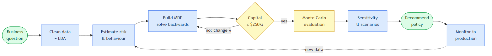
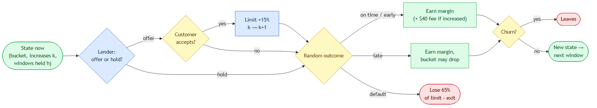
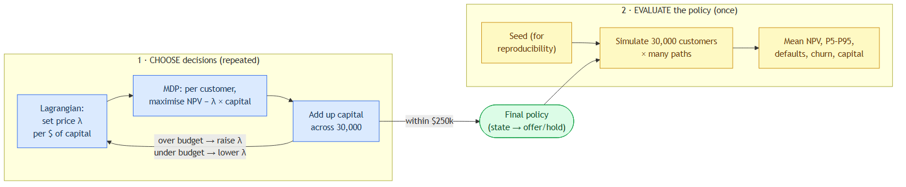

# The Model Step by Step

A short walk through every step of the project: what each step does, why it is needed, and how it feeds the next one. **Real** marks a figure from the analysis or the [report](../report.md). **Toy** marks a made-up number used only to explain an idea.

## 1. The business question

A digital lender has **30,000 customers** (real). Every 60 days a customer becomes *eligible* for a limit increase. The lender can **offer** (+15% of the starting loan) or **hold**. The customer may accept or refuse, then pay on time, pay late, default, or leave (churn).

**Goal:** make as much money as possible, measured as **NPV** (future cash in today's dollars, discounted at 19% a year), without letting **risk-weighted capital** go over **$250,000**. Capital is the cash the lender must hold back against possible losses. Riskier customers need more of it (8% / 12% / 20% of the extra exposure for prime / near-prime / subprime).

**Why not offer an increase to everyone?** Each increase earns a $40 fee, but it also uses up capital and makes default a bit more likely (PD rises 10% per step), and a default loses 65% of the limit. *Toy:* Amina (prime) earns the fee and repays. Brian (subprime) earns the fee but has a 1-in-4 chance of defaulting on a bigger loan. Chloe (near-prime) would accept, but her capital could earn more if it went to Amina. So the question is *who* gets an offer and *when*, not just whether to offer.

## 2. Data checks and EDA

Before building any model, check the inputs: duplicates, missing values, impossible values, loan-size and repayment distributions, and whether the profit formula adds up. A clever optimiser fed bad data just gives confident nonsense.

**Key finding (real):** logistic regression and LightGBM reach a cross-validated **AUC of about 0.50** when predicting who takes an increase. 0.5 means a coin flip: the static features cannot rank customers. That does not prove behaviour is random. It means *this dataset* does not hold the signal. So each customer's own 2023 history is used instead (step 4). Details: [Can uptake be predicted?](03-can-uptake-be-predicted.md)

Always keep four things apart: **observed** data (loan size, on-time %), **estimates** (acceptance probability), **assumptions** (LGD 65%, churn 2%), and **formula-derived** fields (the profit column). Defaults, losses, churn and capital were **not in the data**. They are assumptions, and step 8 tests them.

## 3. Risk buckets and Bayesian updating

**Buckets (real rule):** prime ≥95% on-time, near-prime 85–95%, subprime <85%.

A customer's on-time rate is an *estimate* of their true reliability, and new repayments should move it. The **Beta distribution** handles this with simple counts: Beta(a, b) ≈ "a on-time payments and b late ones seen so far", and its mean is a/(a+b).

*Toy (the method is real: prior = Beta(20q, 20(1−q)), worth about 20 past loans):* a customer at 90% starts at Beta(18, 2), mean 0.90, so near-prime.
- 3 on-time + 1 late → Beta(21, 3), mean 0.875 → **still near-prime**.
- 2 late instead → Beta(18, 4), mean 0.818 → **drops to subprime**.

Two separate steps happen here: *estimating* reliability (the Beta) and *labelling* the customer (the bucket cut-offs). Repeat this across everyone and the result is a set of **transition probabilities**, e.g. "a prime customer stays prime 90% of the time". These are averages over many customers, not a promise about any one person. Details: [Risk buckets and Bayesian updating](06-risk-buckets-and-bayesian-updating.md)

## 4. Customer behaviour as probabilities

**Acceptance (real formula):** â = (n + 1) / 7, where n = increases the customer took in 2023.
*Where it comes from:* start with Beta(1, 1), which means "no idea" (one imaginary yes, one imaginary no). Assume about 5 offers, n of them accepted. The posterior is Beta(1+n, 1+5−n), with mean (n+1)/7. *Toy:* n = 2 → 3/7 ≈ 43%.

⚠️ **The "5 offers" is an assumption** (5 is the observed maximum). The data records increases *taken*, not offers *made*, so the real denominator is unknown.

A 10% default probability does not mean a customer *will* default. It means that across many imagined repeats of the same situation, about 1 in 10 would. The MDP uses these probabilities as *expected values*, and the Monte Carlo *draws* random outcomes from them.

## 5. The MDP: deciding now while thinking ahead

An **MDP (Markov decision process)** has four parts:

| Part | In this project |
|---|---|
| **State** | (bucket, increases so far k, windows held h) |
| **Action** | offer or hold |
| **Transition** | probabilities of accept / on time / late / default / churn, and of changing bucket |
| **Reward** | margin + $40 fee − 65% × limit if default, discounted |

**Markov** means the current state carries all the history that matters. That is why k and h are part of the state.

**Bellman equation:** value of an action = reward now + discounted, probability-weighted value of where you end up.
Q_t(s, a) = R(s, a) + δ · Σ P(s′|s, a) · V_{t+1}(s′), and V_t(s) = max over a of Q_t(s, a).

**Backward induction:** solve the *last* window first, where there is no future to worry about. Then step back one window at a time, reusing the values already computed. The result is a table: for every state and time, *offer or hold*.

*Toy, 2 periods, no discounting.* Rewards: Good customer offer 8 / hold 6. Risky customer offer −4 / hold 2. Offering makes a Good customer Risky 60% of the time; holding only 10%.
- **Period 2 (last):** Good → offer (8). Risky → hold (2). So V₂(Good) = 8 and V₂(Risky) = 2.
- **Period 1, Good:** offer = 8 + 0.4×8 + 0.6×2 = **12.4**. Hold = 6 + 0.9×8 + 0.1×2 = **13.4**.
- **Hold wins now, even though offering pays more today.** That is the whole point of looking ahead.

**Vectorised** = the same calculation done for all states and customers at once with NumPy arrays instead of Python loops. It makes things fast, but it does **not** enforce the capital limit. Details: [Markov decision processes](07-markov-decision-processes.md), [The optimisation model](08-the-optimisation-model.md)

## 6. The capital limit and the Lagrangian

Each customer's MDP can be solved on its own, but they all share **one $250k budget**. That shared budget is what ties them together.

**The trick:** do not fight one giant 30,000-customer problem. Put a **price λ on each dollar of capital** and let every customer solve:

> maximise NPV − λ × capital used

*Toy:* an offer adds $30 of NPV and uses $200 of capital. At λ = 0.10 → 30 − 20 = **+10, offer**. At λ = 0.20 → 30 − 40 = **−10, hold**. A higher λ means fewer offers and less capital used.

**Bisection loop:** pick λ → solve all MDPs → add up capital → over budget? raise λ : lower λ → halve the gap → repeat. λ is the **shadow price**: about how much NPV one more dollar of budget would earn.

**Watch out:**
- Decisions are yes/no, so the policy may not hit $250k exactly. Check the final policy against the limit.
- **"Within budget" means *average* capital over 100 simulated paths** (seed 11). Some individual paths could still go over. A strict per-path cap would be a stronger rule.

Details: [Lagrangian, backward induction and Beta-Binomial](09-lagrangian-backward-induction-beta-binomial.md)

## 7. Monte Carlo: testing the chosen policy

The MDP *chooses* the policy. Monte Carlo *tests* it by replaying 2023 many times with random luck.

- **One customer** (*toy*: 70% on time / 20% late / 10% default): draw u in [0, 1). u < 0.70 → on time, 0.70–0.90 → late, ≥ 0.90 → default. u = 0.83 → **late**.
- **Five customers:** five draws might give 3 / 1 / 1, which is 20% default, not 10%. Small samples are noisy.
- **30,000 customers × every window of 2023** = one **path**, a single possible version of the year. It gives NPV, defaults, churn and capital.
- **Many paths** (40 for sensitivity, 100 for headline results) give an average plus a spread (P5–P95). There is nothing special about 40. Add paths until the average and the ranking of strategies stop moving (**convergence**).
- **Seed** = the starting point of the random-number generator, so a run can be **reproduced**. It does *not* set any probabilities. Using the **same seed for two policies** (common random numbers) cuts noise when comparing them. It is not perfect, because different policies use up the random draws in a different order.

Details: [Monte Carlo simulation](10-monte-carlo-simulation.md)

## 8. Results, sensitivity and limits

| Strategy (real, 100 paths) | NPV | Increases | Capital |
|---|---:|---:|---:|
| Historical 2023 | $11.61M | 61,874 | $2.61M |
| Grant whenever eligible | $11.63M | 66,158 | $2.80M |
| Scorecard (prime + near-prime) | $13.07M | 52,173 | $1.99M |
| Optimal, no capital limit | $14.89M | 20,405 | $0.48M |
| **Optimal, $250k limit** | **$14.84M** | **13,401** | **$0.25M** |

**Trade-off:** the optimal policies make fewer offers and earn more, but churn roughly doubles (about 10% → 21–23%), because refused customers leave more often. NPV alone is not the full story.

**Sensitivity analysis** changes an *assumption* (LGD 50%/80%, churn, κ, macro scenario), re-solves the policy, and asks: *"Is the recommendation still good if this assumption is wrong?"* Monte Carlo draws luck *inside* one set of assumptions. Sensitivity changes the assumptions themselves, with Monte Carlo run inside each case. The assumptions that move NPV most should be checked against real data first. Details: [Sensitivity analysis](12-sensitivity-analysis.md)

**Limits:** it is a **retrospective replay**: 2023 behaviour was used both to build and to test the policy, so the result is optimistic. LGD, churn, κ and the macro effects are assumptions. For production: validate on next-period data, calibrate predicted vs actual acceptance and default, log every offer and outcome, keep a human sign-off and fairness checks, and re-fit regularly.

## 9. Self-test

1. Why an MDP? Because today's offer changes tomorrow's risk and options. A one-shot rule cannot see that.
2. Why does backward induction work? The last period has no future, so it is easy. Every earlier period reuses values already solved.
3. What does raising λ do? Capital gets more expensive, so fewer offers and less capital used.
4. What does a seed do? It makes runs reproducible and lets two policies share the same luck. It does not set any probabilities.
5. Why is average capital ≤ $250k not the same as "always ≤ $250k"? An average can hide individual paths that go over.

## In 30 seconds

Uptake could not be predicted from the features (AUC 0.5), so each customer's behaviour is modelled from their own history using Beta posteriors. Limit increases are framed as a finite-horizon MDP over (bucket, increases, windows held) and solved by vectorised backward induction. The $250k capital budget couples customers, so capital is priced with a Lagrange multiplier found by bisection. A Monte Carlo replay of 2023 puts NPV at $14.84M against $11.61M historically, using a tenth of the capital. The main caveats: it is a retrospective replay, and LGD and churn are assumptions, which is why they are stress-tested.
