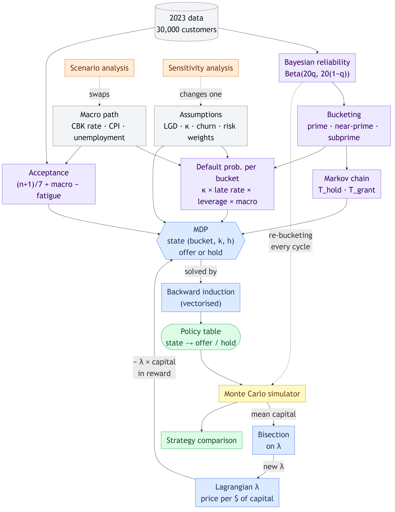
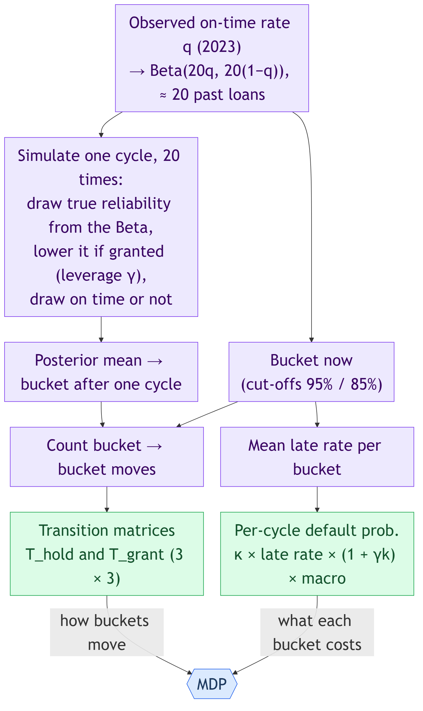
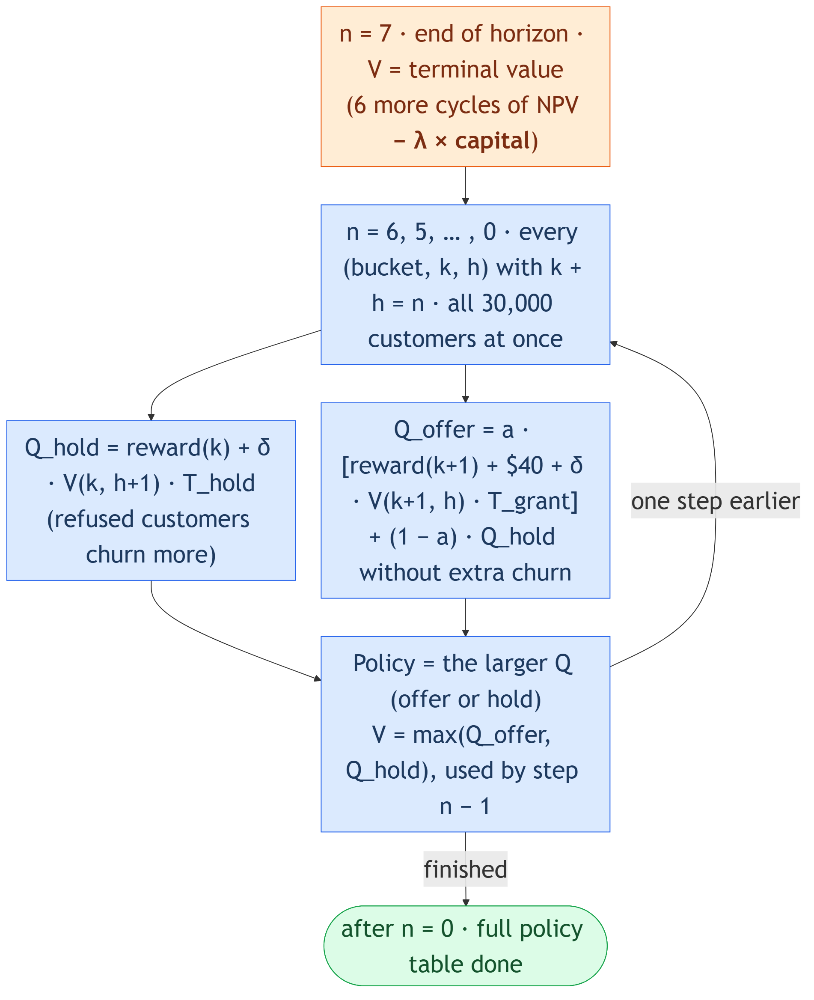
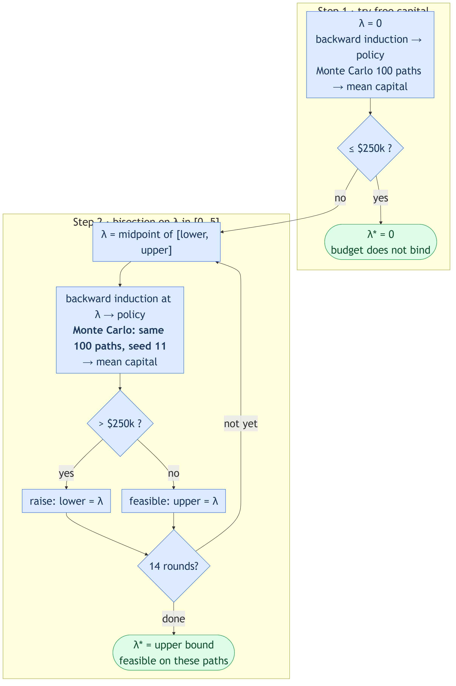
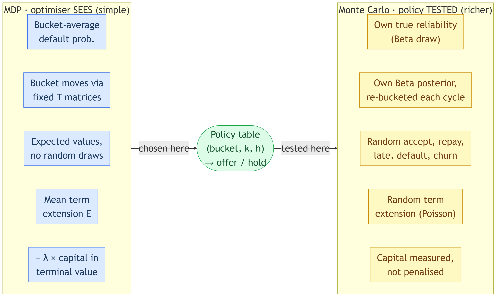
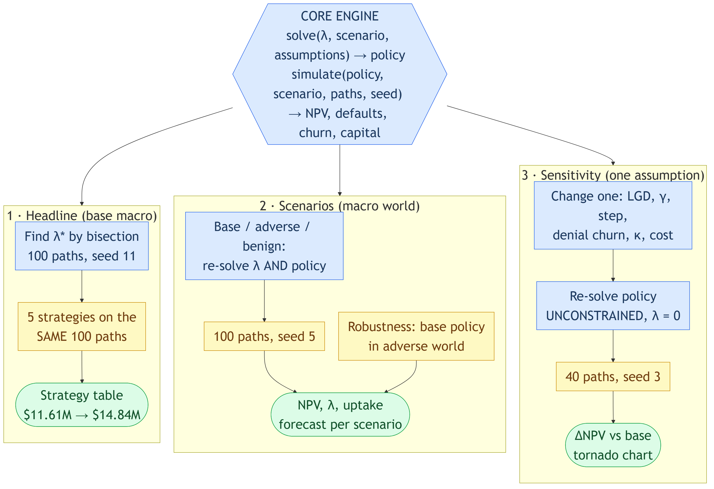

# How the Pieces Connect

How the concepts **connect**: what feeds what, what calls what, and what gets re-run when. The other notes explain each concept on its own; this one is the map between them.

**Colour key used in every diagram:** grey = data / assumptions · purple = estimation (Beta, buckets, Markov chain) · blue = optimisation (MDP, backward induction, λ) · yellow = Monte Carlo · orange = stress tests · green = outputs.

**In one sentence:** bucketing and Bayesian updating produce the *inputs*, the MDP plus backward induction turns inputs into a *policy*, the Lagrangian λ stops that policy using too much *capital*, Monte Carlo *measures* the policy (including its capital use, to tune λ), and scenarios and sensitivity *change the inputs* and run the whole chain again.

## 1. The big picture

**How to read it, top to bottom:**
- **Inputs layer (grey and purple):** data and assumptions become four model inputs: the bucket, the transition matrices, the default probability per bucket, and the acceptance probability.
- **Decision layer (blue):** the MDP combines those inputs. Backward induction is just *how the MDP is solved*. Its output is a policy table.
- **The λ loop (blue ↔ yellow):** λ goes **into** the MDP reward. Monte Carlo measures the policy's capital, and bisection sends back a new λ. It is a loop, not a straight line.
- **Test layer (orange):** scenarios and sensitivity sit *outside* everything else. They swap the inputs, then the whole chain re-runs.
- **The dotted Beta → Monte Carlo arrow:** the Bayesian update is used **twice**: once up front to build the Markov chain, and again inside every simulated cycle to re-bucket each customer.

## 2. What each piece takes in and gives out

| Concept | Takes in | Gives out | Used by |
|---|---|---|---|
| **Bayesian reliability** | on-time rate q, n₀ = 20 | Beta(20q, 20(1−q)) per customer | bucketing, Markov chain, simulator |
| **Bucketing** | posterior mean, cut-offs 95% / 85% | prime / near-prime / subprime | MDP state, default prob., capital weight, Markov chain |
| **Markov chain** | buckets before and after one simulated cycle | T_hold, T_grant (3 × 3) | MDP transitions |
| **Default prob.** | κ, bucket late rate, leverage k, macro | per-cycle PD | MDP rewards, simulator |
| **Acceptance** | n increases taken in 2023, macro, fatigue k | a = chance of accepting | MDP (Q_offer), simulator |
| **MDP** | all of the above + λ | a definition of the problem: states, actions, rewards | backward induction |
| **Backward induction** | MDP + terminal value | V (values) and the policy table | Monte Carlo, bisection |
| **Lagrangian λ** | bisection result | penalty −λ × capital in the terminal value | MDP |
| **Bisection** | mean capital from Monte Carlo | the next λ to try; final λ* | Lagrangian |
| **Monte Carlo** | policy, scenario, assumptions, seed, paths | NPV, defaults, churn, capital per path | bisection, strategy table, scenarios, sensitivity |
| **Scenarios** | 3 macro paths | a whole new world → re-solve λ and policy | final report |
| **Sensitivity** | one changed assumption | ΔNPV vs base | final report |

**Three dependencies that are easy to miss:**
1. **Bucket drives capital.** Risk weights are 8% / 12% / 20% *by bucket*. So bucketing affects the capital constraint directly, not just default risk.
2. **λ enters only through the terminal value.** In the solver, λ is passed only to the terminal-value function, which subtracts λ × K_bucket × extra exposure at the end of the horizon. Backward induction then carries that penalty back to every earlier decision.
3. **Monte Carlo is upstream *and* downstream of λ.** It measures capital to tune λ, and later it reports the results.

## 3. Bucketing → Markov chain → MDP inputs

- **Bayesian updating and bucketing are two separate steps.** The Beta *estimates* reliability. The cut-offs *label* it. Moving a cut-off changes the buckets without changing any estimate.
- **The Markov chain is itself a small simulation.** The transition step runs one cycle 20 times over all 30,000 customers and counts bucket-to-bucket moves. The grant version lowers reliability through leverage, so **T_grant is slightly worse than T_hold**. This is how "giving an increase makes a customer riskier" reaches the MDP.
- **The MDP sees buckets, never individual customers' Betas.** That simplification is deliberate. Section 6 shows how the simulator checks it.

## 4. Inside the MDP: where each input enters backward induction

| Input | Where it enters |
|---|---|
| T_hold / T_grant (Markov chain) | the "where you end up" part of Q_hold / Q_offer |
| Default prob. (from bucket) | the reward(k) term: margin earned or 65% LGD lost |
| Acceptance a | Q_offer mixes the accept case (weight a) and the refuse case (1 − a) |
| Denial churn | lowers Q_hold when the customer wanted an increase |
| λ (Lagrangian) | **only** in the terminal value, then passed back through V |
| Macro scenario | scales default prob. and acceptance by calendar month |
| Discount δ (19% a year) | multiplies every next-step value |

**State grid:** (bucket 3) × (k 0–7) × (h 0–7), for every customer at once (`V` has shape 30,000 × 3 × 8 × 8). That is the vectorisation: one NumPy step covers all customers and buckets for a given (k, h).

## 5. The λ loop: MDP ↔ Lagrangian ↔ Monte Carlo

- **Each bisection round = one full backward induction + one 100-path Monte Carlo.** About 16 solves and simulations in total (the λ = 0 try, the upper-bound check, then 14 rounds).
- **"Within budget" is checked on *mean* capital over those 100 paths (seed 11).** It is not a per-path guarantee.
- **The same 100 paths are reused to report results**, so the reported policy is exactly the one that was checked against the budget.
- **Why bisection works:** a higher λ makes capital more expensive, so the policy makes fewer offers and uses less capital. Capital falls as λ rises, so halving the interval converges.

## 6. Two models: one to choose, one to test

- **The optimiser and the simulator are deliberately different.** The MDP is simple enough to solve exactly. The simulator is detailed enough to be realistic.
- **What links them is just the policy table.** The simulator looks up (bucket, k, h) for each customer each cycle, using the bucket the *simulator* computed from that customer's own Beta.
- **Why it matters:** if a policy chosen in the simple world still beats the alternatives in the rich world, the simplification is not what drives the result.
- **Capital is treated differently in each:** *penalised* in the MDP (through λ), *measured* in the simulator (terminal value run with λ = 0).

## 7. The three experiments on top of the core

| Run | λ re-solved? | Policy re-solved? | Paths | Seed | Question it answers |
|---|---|---|---|---|---|
| **Headline** | yes (bisection) | yes | 100 | 11 | Which strategy is best in the base world? |
| **Scenarios** | yes, per world | yes, per world | 100 | 5 | What is the best policy if the economy is worse or better? |
| **Robustness** | no | no (base policy) | 100 | 5 | What if the policy is *not* adapted to a bad economy? |
| **Sensitivity** | no (λ = 0, unconstrained) | yes, per case | 40 | 3 | Which assumption moves NPV the most? |

**Scenario vs sensitivity:** a scenario changes the *whole macro world* (rates, CPI and unemployment together) and keeps the capital limit. Sensitivity changes *one model assumption* and drops the capital limit. Both re-solve the policy, so both answer "best policy in the changed world". Only the robustness run answers "old policy in the new world".

**Common random numbers:** within each run, every compared policy uses the same seed, so they get the same random luck and the differences between them are less noisy.

## 8. Pairs that get confused

| Pair | How they relate |
|---|---|
| MDP vs backward induction | The MDP *defines the problem*. Backward induction is *the method that solves it*. |
| MDP vs Markov chain | The Markov chain = how buckets move *on their own*. The MDP = a Markov chain *plus decisions and rewards*. |
| Bayesian updating vs bucketing | Updating *estimates* reliability. Bucketing *labels* it with cut-offs. |
| Lagrangian vs bisection | λ is the *price*. Bisection is the *search* that finds the right price. |
| MDP vs Monte Carlo | The MDP *chooses* (expected values, no randomness). Monte Carlo *tests* (random draws). |
| Monte Carlo inside vs after λ | Inside: measures capital to tune λ. After: reports NPV, defaults, churn. Same simulator, same 100 paths. |
| Monte Carlo vs sensitivity | Monte Carlo varies *luck* under fixed assumptions. Sensitivity varies *the assumptions*. |
| Scenario vs sensitivity | Scenario = the whole economy changes. Sensitivity = one parameter changes. |
| Seed vs probability | The seed fixes *which* random numbers come out. The probabilities fix *how likely* each outcome is. |
| Unconstrained vs constrained policy | Same MDP with λ = 0 vs λ = λ*. Similar NPV ($14.89M vs $14.84M), but capital of $0.48M vs $0.25M. |

## 9. The whole thing on a whiteboard

1. **Data → Beta → buckets → (T matrices, PD per bucket)**, and **data → acceptance**.
2. **Those inputs + λ → MDP → backward induction → policy.**
3. **Policy → Monte Carlo → mean capital → bisection → new λ → back to step 2**, until within $250k.
4. **Final policy → Monte Carlo (same paths) → strategy table.**
5. **Wrap steps 1–4 in loops:** 3 macro scenarios (re-solve λ) and 10 single-assumption changes (re-solve with λ = 0).
