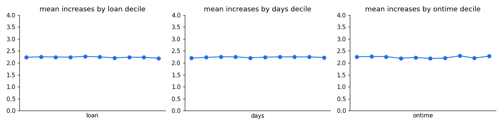

# Reading the Decile Charts

What the three charts at the end of section 1 of the [report](../report.md) show, how to read them, and what they prove.

## 1. What a decile is

A **decile** is one tenth of the customers, after sorting them by some measure.

For the left-hand chart, all 30,000 customers are sorted by initial loan size, from smallest to largest, and cut into ten equal groups of 3,000:
- decile 1 = the 3,000 smallest loans ($500–$960)
- decile 10 = the 3,000 largest loans ($4,534–$4,999)

Each dot is one decile. Its height is the **average number of limit increases** those 3,000 customers took in 2023. The middle and right-hand charts do the same for days since last loan and on-time repayment rate.

**Why deciles?** Plotting 30,000 individual customers would be an unreadable cloud, because each customer took 0, 3, 4 or 5 increases. Grouping into deciles averages out individual noise and shows the **trend**, if there is one.

## 2. What each chart shows

### Left: by initial loan size

| Decile | Loan range | Average increases |
|---|---|---|
| 1 (smallest) | $500–$960 | 2.23 |
| 5 | $2,311–$2,761 | 2.27 |
| 10 (largest) | $4,534–$4,999 | 2.19 |

All ten deciles fall between **2.19 and 2.27**. A customer with a $500 loan took as many increases as one with a $5,000 loan.

### Middle: by days since last loan

| Decile | Days | Average increases |
|---|---|---|
| 1 (most recent) | 0–36 | 2.20 |
| 10 (longest ago) | 327–364 | 2.23 |

All ten fall between **2.20 and 2.25**. Recent and lapsed borrowers took the same number.

### Right: by on-time repayment rate

| Decile | On-time rate | Average increases |
|---|---|---|
| 1 (worst payers) | 80.0–82.0% | 2.25 |
| 10 (best payers) | 97.9–100.0% | 2.28 |

All ten fall between **2.19 and 2.30**. The worst payers took as many increases as the best.

## 3. How to read a flat line

**If a feature mattered, the line would slope.** For example, if better payers received more increases, the on-time chart would rise from left to right, say from 1.5 to 3.0. If larger loans made customers less likely to take increases, the loan chart would fall.

**Every line here is flat**, sitting at about **2.24**, the overall average for the whole book. Knowing which decile a customer is in tells you nothing about how many increases they took.

**The y-axis runs from 0 to 4 on purpose.** On a zoomed-in scale (say 2.15 to 2.30), the small wobbles would look like dramatic peaks and troughs. They are only random noise: the biggest gap between any two deciles is about 0.1 of an increase. Showing the full range keeps the chart honest.

**About the 2.24:** no individual customer took 2.24 increases. Everyone took 0, 3, 4 or 5. The 2.24 is an average across a mix of about 44% zeros and 56% customers on 3–5, and that mix is the same in every decile.

## 4. What the charts prove, and why it matters

They are the **visual version** of the statistical tests in [Can uptake be predicted?](03-can-uptake-be-predicted.md): logistic regression and LightGBM both score an AUC of about 0.50, and the permutation test confirms it.

**Two conclusions follow:**

1. **No feature predicts uptake.** So no feature-based uptake model is built; it would only fit noise. Each customer's own 2023 behaviour is used instead.
2. **The 2023 increases were not risk-based.** This is the business finding. The on-time chart is the key one: subprime customers (80–85% on time) received just as many increases as prime customers (95–100%). A risk-aware policy would show a rising line. The flat line is direct visual evidence of the value the optimised policy captures by targeting increases by risk.

## 5. Weaknesses to know about

- **The x-axes have no tick labels.** A viewer cannot see the decile ranges from the chart alone; the tables in section 2 give them. When presenting, say what the axis means ("smallest loans on the left, largest on the right").
- **Averages hide the distribution.** A flat average could, in principle, conceal a shift between zeros and fives that cancels out. The classifier tests rule that out: the share taking *any* increase and the 3-vs-4-vs-5 split are also unpredictable.
- **One feature at a time.** These charts cannot show combinations, such as "small loans *and* poor payers". LightGBM tests those interactions, and it found nothing either.

## 6. In 30 seconds

Each chart sorts customers into ten equal groups by one feature (loan size, days since last loan, on-time rate) and shows the average number of increases in each group. If a feature mattered, the line would slope. All three are flat at about 2.2. The on-time chart is the telling one: the worst payers got as many increases as the best. So the 2023 increases were not tied to risk at all, and that is the gap the optimised policy closes.

**Questions to check understanding:**
- *Why is the y-axis so tall?* To avoid exaggerating noise. The largest gap between deciles is about 0.1 of an increase.
- *Could there be a pattern in combinations of features?* LightGBM checks interactions and also scored an AUC of 0.50, so no.
- *Why deciles rather than a scatter plot?* Each customer has only 0, 3, 4 or 5 increases, so a scatter plot would be four horizontal bands. Deciles show the trend.
