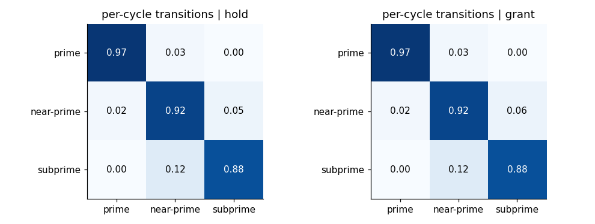

# Risk Buckets and Bayesian Updating

How a customer's risk bucket is updated as new repayment evidence arrives, why it is called Bayesian, how it works in the model, and three weaknesses worth knowing.

## 1. The idea

**Bayesian re-bucketing** means updating a customer's estimated credit-risk category as new repayment evidence arrives, while allowing for uncertainty about how reliable they really are.

Customers are placed in a bucket by their on-time repayment rate:

| Estimated on-time rate | Bucket |
|---|---|
| 95% or higher | Prime |
| 85% to below 95% | Near-prime |
| Below 85% | Subprime |

Re-bucketing lets those buckets **change** as the customer keeps repaying, or does not.

**Why it is needed:** a customer classified as prime at 96% on time takes an increase and starts paying late. Should they stay prime? Not necessarily. The model should update its estimate of their reliability and move them if the evidence supports it.

**It is two steps, not one:**
1. **Bayesian updating** estimates the customer's underlying repayment reliability.
2. **Re-bucketing** is the classification step that follows: mapping that estimate onto prime, near-prime or subprime.

## 2. The four steps

1. **Start with existing evidence:** previous repayment history, summarised as a Beta distribution.
2. **Observe new repayment outcomes:** on time, late or default.
3. **Update the Bayesian estimate:** combine the previous estimate with the new evidence.
4. **Assign the new bucket:** compare the updated estimate with the thresholds.

## 3. The maths

Call the customer's true probability of paying on time p. Uncertainty about p is described by a Beta distribution:

**p ~ Beta(α, β)**

Think of α as "on-time payments seen" and β as "failures seen". The estimate is the **mean**:

**E[p] = α ÷ (α + β)**

**The update rule** (derived in [note 09](09-lagrangian-backward-induction-beta-binomial.md), Part C):
- each on-time payment adds 1 to α;
- each late payment or default adds 1 to β.

**Worked example:** start at Beta(19, 1).
- Estimate: 19 ÷ 20 = **95%**, exactly on the prime threshold.
- Observe five repayments: three on time, two late.
- Update: Beta(19 + 3, 1 + 2) = **Beta(22, 3)**.
- New estimate: 22 ÷ 25 = **88%**, so the customer moves to **near-prime**.

## 4. Why "Bayesian"?

The estimate combines two sources:
- **The prior:** what the model believed before the new outcomes (the customer's history).
- **The evidence:** what happened in the latest cycles.

The result is the **posterior**, reflecting both.

**The strength of the prior matters.** A prior built from a long record moves slowly; a prior built from a short one moves quickly. Prior strength controls how much a single new repayment can change the bucket.

## 5. How it works in the model

### The prior

Each customer starts at **Beta(20 × on-time rate, 20 × (1 − on-time rate))**. The 20 says "treat the observed on-time rate as worth about 20 loans of evidence".

| Customer's on-time rate | Prior | Starting estimate |
|---|---|---|
| 95% | Beta(19, 1) | 95% (same as the worked example) |
| 97% | Beta(19.4, 0.6) | 97% |
| 90% | Beta(18, 2) | 90% |

So every customer starts in the bucket their data puts them in.

### Two different quantities in the simulator

| Quantity | What it is | Does it change? |
|---|---|---|
| **True reliability, q** | Drawn once per simulated path from the Beta prior: what the customer is really like | No, fixed for the path |
| **Estimated reliability** | The posterior mean, built from the repayments the lender observes | Yes, after every repayment |

The customer's **behaviour** comes from the true q. Their **bucket** comes from the estimate, because that is all a real lender can see. That mirrors the real world: true reliability is never observed, only repayment history.

### Each 60-day cycle in the simulator

1. The customer is in a bucket (from their current estimate).
2. The policy decides offer or hold for that bucket.
3. A repayment outcome is drawn from their **true** reliability (plus leverage and macro effects).
4. **On time:** α + 1. **Late or default:** β + 1. A defaulted customer leaves the book.
5. Re-bucket from the new posterior mean.
6. The next decision uses the new bucket.

### How it reaches the optimiser (the MDP)

The optimiser does **not** update individual customers. Instead, one cycle of Bayesian updating is simulated across the whole book, counting how often customers move between buckets. That gives two **transition matrices**, one for hold and one for grant:

**How to read it:** each row is where a customer starts, each column where they end up after one cycle. For example, a subprime customer has a 12% chance of moving up to near-prime in one cycle and an 88% chance of staying subprime.

Granting slightly raises the chance of sliding down (near-prime → subprime is 6% after a grant vs 5% after a hold), because a bigger limit means more repayment strain.

**So re-bucketing reaches the MDP as probabilities**, the P(r′ | r, action) in the Bellman equation. The simulator does it customer by customer.

## 6. Three weaknesses worth knowing

### Weakness 1: one late payment moves a prime customer

A long, reliable history might be expected to protect a customer from one bad cycle. With a prior worth 20 loans, it does not, for anyone near a threshold. After one late payment the estimate becomes 20q ÷ 21:

| Starting on-time rate | After one late payment | After one on-time payment |
|---|---|---|
| 95% (prime) | 90.5%, **near-prime** | 95.2%, prime |
| 97% (prime) | 92.4%, **near-prime** | 97.1%, prime |
| 99% (prime) | 94.3%, **near-prime** | 99.0%, prime |
| 99.75% (prime) | 95.0%, just stays prime | 99.8%, prime |
| 86% (near-prime) | 81.9%, **subprime** | 86.7%, near-prime |
| 90% (near-prime) | 85.7%, stays near-prime | 90.5%, near-prime |
| 94.75% (near-prime) | 90.2%, near-prime | 95.0%, **prime** |
| 84% (subprime) | 80.0%, subprime | 84.8%, subprime |

**Two consequences:**
- **Only a customer at about 99.75% or better stays prime after a single late payment.** Practically every prime customer is demoted by one slip.
- **The way back is slow.** A 97% customer demoted by one late payment needs **11 on-time payments in a row**, nearly two years of 60-day cycles, to climb back to prime.

**Why it happens:** prime customers have very few "failures" in their prior (β of 0.6 for a 97% customer), so a single failure more than doubles β. Near-prime customers comfortably inside their band are much more stable.

So buckets are sticky only for customers well inside a band; anyone near a threshold flips on one repayment.

**Improvements:**
- use a **stronger prior** (worth more loans), so one repayment moves the estimate less;
- add **hysteresis**: for example, require two late payments in a row before a downgrade, or a margin beyond the threshold before an upgrade;
- **weight recent behaviour** explicitly, if recent payments should count more than old ones.

### Weakness 2: late payments and defaults count the same

Both add 1 to β. A real model should distinguish them. Here it matters little, because a defaulted customer **leaves the book**, so their bucket is never used again. A late but cured payment is the only "failure" that affects future decisions.

### Weakness 3: the optimiser sees probabilities, not individuals

As section 5 explains, the MDP works with bucket transition probabilities. That is a simplification: the optimiser does not know that a 94.9% near-prime customer is one payment from prime while an 85.1% one is one slip from subprime. The simulator does, which is part of why the policy is tested there.

## 7. In 30 seconds

Each customer's repayment reliability is a Beta distribution, starting from their on-time rate with the weight of about 20 loans. After every simulated repayment it is updated: an on-time payment adds to the successes, a late payment or default to the failures. The customer is then re-bucketed from the posterior mean against the 95% and 85% thresholds. The bucket is part of the MDP state, so later decisions respond to changes in risk. One thing to change: with a prior worth only 20 loans, a single late payment demotes almost any prime customer, and it takes about 11 on-time payments to recover. A stronger prior, or two misses before a downgrade, stops the model overreacting to one slip.

## 8. Self-test

1. **What is the difference between Bayesian updating and re-bucketing?** Updating estimates reliability; re-bucketing classifies that estimate into a bucket.
2. **What is Beta(19, 1)'s estimate?** 19 ÷ 20 = 95%.
3. **Beta(19, 1) plus 3 on time and 2 late?** Beta(22, 3), so 88%: near-prime.
4. **What does the "20" in the prior mean?** The on-time rate is treated as worth about 20 loans of evidence.
5. **Why does one late payment demote a 97% customer?** Their prior has only 0.6 "failures", so one more more than doubles β, and the estimate drops to 92.4%.
6. **How does re-bucketing reach the MDP?** Through the hold and grant transition matrices, estimated by simulating one round of updating across the book.
7. **Why does the simulator use both true and estimated reliability?** Behaviour comes from the truth; the bucket comes from what the lender can observe.

## Related notes

- [09 Lagrangian, backward induction and Beta-Binomial](09-lagrangian-backward-induction-beta-binomial.md), Part C: the Beta-Binomial derivation
- [10 Monte Carlo simulation](10-monte-carlo-simulation.md): the simulator cycle where re-bucketing happens
- [07 Markov decision processes](07-markov-decision-processes.md): how the bucket fits into the MDP state
