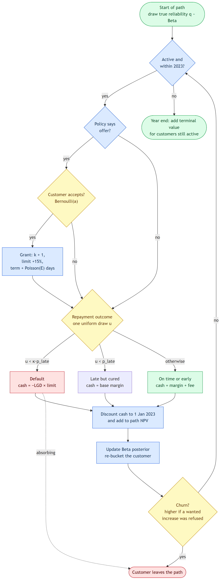

# Monte Carlo Simulation

What Monte Carlo simulation is, why the project uses it, exactly how the simulator works, how to read its results, and its limits.

## 1. The idea in plain words

A **Monte Carlo simulation** answers "what could happen?" by playing out the future many times with random draws, then looking at the spread of results.

Here, each simulated **path** is one possible version of 2023 for the whole book of 30,000 customers. On each path, every customer meets their eligibility windows, the policy decides whether to offer an increase, the customer randomly accepts or declines, they randomly repay early, on time, late or default, and they may randomly leave. Adding up the discounted cash flows gives one portfolio NPV for that version of 2023. Repeating 100 times gives 100 NPVs. Their average is the expected NPV; their spread shows how much results could vary.

**The name:** it comes from the Monte Carlo casino. The method is "rolling dice" with a computer.

## 2. Why simulate, when the MDP already gives values?

The MDP (backward induction) already calculates the expected value of each decision. So why simulate?

| Reason | Explanation |
|---|---|
| **To test the policy in a richer world than it was built in** | The MDP sees only three risk buckets. The simulator gives every customer their own true reliability, draws stochastic term extensions, and re-buckets customers from their actual repayment history. If the policy still wins here, the optimiser's simplifications are not what drives the result. Otherwise the evaluation would be circular. |
| **To compare any policy, not just MDP policies** | The historical 2023 policy, "grant whenever eligible" and the scorecard rule are not MDP solutions. The simulator can run any rule that says offer or hold. |
| **To see a distribution, not just an average** | The P5–P95 range, default and churn rates, and capital used all come from the paths. |
| **To forecast uptake over time** | Counting simulated grants by month gives the monthly uptake forecast, with bands. |
| **To measure capital use for the λ search** | The bisection needs the expected capital each trial policy uses. The simulator provides it. |

## 3. How one simulated cycle works



### At the start of a path

**Each customer's true reliability is drawn:** q ~ Beta(20 × on-time rate, 20 × (1 − on-time rate)).

The observed on-time rate is only an estimate. A customer at 90% might truly be an 87% or a 93% payer. Drawing q captures that uncertainty: on different paths the same customer behaves slightly differently. The 20 is the "prior strength": it treats the observed rate as worth about 20 loans of evidence.

### At each 60-day eligibility window (up to 7 per customer in 2023)

1. **Is the customer still active?** Not defaulted, not churned, and the window falls within 2023.
2. **Does the policy offer?** It looks up the customer's current observed bucket, increases so far (k) and windows without one (h).
3. **Does the customer accept?** A Bernoulli draw with probability a = σ(logit(â) + macro shift − 0.10k): their own propensity from 2023 behaviour, adjusted for the macro month and fatigue.
4. **If granted:** k rises by one, the limit rises 15% of the initial loan, and the cycle lengthens by a **Poisson** number of days around the customer's mean extension E.
5. **Repayment outcome:** one uniform random number u decides it.
   - late probability p_late = (1 − q) × (1 + γk) × macro multiplier
   - **default** if u < κ × p_late (κ = 25% of late payments default)
   - **late but cured** if u < p_late
   - otherwise **on time**, of which 30% repay **early** (another draw)
6. **Cash flow:** default loses LGD × current limit. Otherwise the customer pays the base margin, plus the $40 fee if an increase was granted (80% of it if repaid early).
7. **Discount** the cash to 1 January 2023 at 19% a year, using the actual day it arrives.
8. **Update the history:** a good repayment adds to the Beta posterior's "successes", a late payment or default to its "failures". The customer is re-bucketed from the new posterior mean. **This is the dynamic eligibility the problem asks for:** buckets move with behaviour ([note 06](06-risk-buckets-and-bayesian-updating.md)).
9. **Churn draw:** 2% per cycle, plus 6% if the customer wanted an increase but the policy refused it.
10. **Advance the clock** by the cycle length.

### At the end of the year

Customers still active get a **terminal value**: the expected value of six more cycles beyond 2023, from the same formula the MDP uses (without the capital charge). This stops a policy from looking good by loading risk into 2024.

### What each path returns

- Portfolio NPV (sum over all customers)
- Share of customers who defaulted, and who churned
- Number of increases granted
- Risk-weighted capital held at year end
- Grants by month (for the uptake forecast)

## 4. How it runs fast: vectorisation

The simulator never loops over customers. Every quantity is a NumPy array of shape **(30,000 customers × S paths)**, and each step updates all of them at once. With S = 100 that is 3 million customer-paths per array, and the whole simulation is about 7 loop steps (one per eligibility window), each a handful of array operations.

```python
# shape (N, S): every customer on every path at once
u = rng.random((N, S))
d    = act & (u < kappa * plate)          # default
late = act & ~d & (u < plate)             # late but cured
ok   = act & ~d & ~late                   # on time
```

Customers are independent given the macro path, which is what makes this vectorisation valid. (It is also a limitation; see section 7.)

## 5. Design choices worth knowing

### Common random numbers

Every random draw has the same array shape whatever the policy, and every strategy is run with the same seed (11). So on path 7, customer 1,234 gets the same reliability, the same acceptance draw and the same repayment draw under every strategy. Only the policy's decisions differ.

This is called **common random numbers**. Comparisons between strategies are **paired**: the noise largely cancels, so the difference between two policies is measured far more precisely than either policy's NPV on its own.

### Path counts by purpose

| Use | Paths (S) | Why |
|---|---|---|
| Strategy comparison (main table) | 100 | Reported results; enough for a stable mean |
| Macro scenarios | 100 | Same |
| Sensitivity analysis | 40 | Ten cases to run; differences are large |
| λ bisection (inside the search) | 100, the same paths as the main table | The reported policy is exactly the one checked against the budget (an earlier version used 16 paths and overshot the budget by 0.4%) |

### How precise are the averages?

The NPV P5–P95 range for each strategy is about $0.5M wide. For a roughly normal spread that means a standard deviation of about $0.15M. With 100 paths, the standard error of the mean is about $0.15M ÷ √100 ≈ **$15k**. The gap between the optimised and historical policies is about **$3.2M**, roughly 200 standard errors. Monte Carlo noise does not threaten the conclusion.

## 6. How to read the results

| Strategy (base macro) | NPV mean | NPV P5–P95 | Default rate | Churn |
|---|---|---|---|---|
| Historical 2023 | $11.61M | 11.37–11.87M | 14.3% | 10.3% |
| Optimal + capital limit | $14.84M | 14.59–15.06M | 13.4% | 22.6% |

- **NPV mean:** the expected portfolio value under that policy, across simulated versions of 2023.
- **P5–P95:** 90% of simulated paths fell in this range. It shows **randomness in outcomes with the parameters held fixed**.
- **Default and churn rates:** averaged over customers and paths.

**What P5–P95 is not:** it is not a confidence interval for the true NPV. It does not include uncertainty in the assumed parameters (LGD, κ, churn), which is much bigger. The [sensitivity analysis](12-sensitivity-analysis.md) handles that separately.

## 7. Limitations, and how to improve them

1. **The spread is too narrow for real risk.** Within a scenario, customers default independently, so with 30,000 customers the law of large numbers makes portfolio outcomes very stable. Real portfolios have **correlated** defaults: a shock hits many borrowers at once. **Fix:** draw a random macro path (or a common risk factor, as in the Vasicek one-factor model) **for each path**, so some simulated years are bad for everyone. The P5 would then become a meaningful downside measure.
2. **Parameter uncertainty is excluded.** **Fix:** put distributions on κ, LGD, γ and churn, and draw them per path (a Bayesian or "nested" simulation). The spread then reflects how little is known about the parameters, not only the randomness of outcomes.
3. **100 paths is enough for means, not tails.** A 5th percentile from 100 paths rests on about five observations. **Fix:** 10,000+ paths for tail metrics (value at risk, expected shortfall). That is easy in a batch environment.
4. **Uptake propensities come from the 2023 counts** used to evaluate 2023 (a retrospective replay).
5. **The terminal value is a simple approximation** (six more cycles, no further increases).

## 8. Questions to check understanding

- **Why simulate if the MDP gives expected values?** Three reasons: to evaluate the policy in a richer world than the one it was optimised in, so the test is not circular; to compare policies that are not MDP solutions, like the historical one; and to get distributions and a monthly forecast, not just averages.
- **How many simulations, and is that enough?** 100 paths for the main results. The standard error on mean NPV is about $15k against a $3.2M difference between policies, so yes for the comparison. Tail risk needs 10,000 or more.
- **How is the comparison made fair?** Common random numbers: every strategy sees exactly the same random draws, so differences come from the decisions, not luck.
- **Is the P5–P95 a confidence interval?** No. It is the spread of outcomes with parameters fixed. Parameter uncertainty is bigger, and the sensitivity analysis handles it. Defaults are also independent within a scenario, so the spread understates real tail risk. A shared macro factor per path would fix that.
- **How does it scale?** It is vectorised over customers and paths, so 30,000 × 100 runs in seconds. For millions of customers, simulation splits by customer chunk and runs in parallel, because customers are independent given the macro path.
- **Where is the randomness?** Six draws: each customer's true reliability (Beta), acceptance (Bernoulli), the repayment outcome (uniform), early repayment, term extension (Poisson), and churn.

## 9. Key terms

| Term | Meaning |
|---|---|
| Path | One simulated version of 2023 for the whole book |
| Beta distribution | A distribution for a probability; used for each customer's true reliability |
| Bernoulli draw | A single yes/no random outcome with a given probability |
| Poisson distribution | A distribution for counts; used for term-extension days |
| Uniform draw | A random number between 0 and 1; one draw decides the repayment outcome |
| Common random numbers | Giving every strategy the same random draws so comparisons are paired |
| Standard error | How precisely an average is estimated: standard deviation ÷ √(number of paths) |
| Terminal value | The value of a customer beyond the simulated horizon |
| Vasicek one-factor model | A standard credit-risk model where one common factor drives correlated defaults |
| Value at risk / expected shortfall | Tail-loss measures: a bad-case loss, and the average loss beyond it |
