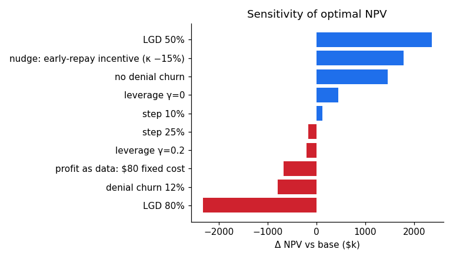

# Sensitivity Analysis

What the sensitivity analysis in section 5 of the [report](../report.md) actually ran, what each row means, and what the results do and do not support. [Note 13](13-raising-profit-and-lowering-defaults.md) covers the nudge and step-size rows in more depth.

**The report's summary:** one assumption at a time is changed, the unconstrained policy re-solved, and its NPV compared with the base case. Loss given default dominates: 50% adds $2.36M and 80% removes $2.33M. The repayment nudge (+$1.79M) and refusal churn (+$1.45M / −$0.80M) come next. The data's $80 fixed-cost reading of profit costs $0.67M, and the leverage effect and step size matter less.

## 1. Why a sensitivity analysis is needed

The data has no defaults, losses, churn or capital (report section 1). Every one of those numbers is **an assumption**. The sensitivity analysis answers: *which assumptions would change the answer if they were wrong?* It ranks the assumptions by how much they matter, which shows where real data is worth collecting first.

## 2. How it was run

1. **Base:** solve the **unconstrained** MDP with all base assumptions, simulate it for **40 paths, seed 3**.
2. **For each case:** change **one** parameter, **re-solve** the policy for that changed world, simulate it for 40 paths with the **same seed 3**.
3. **ΔNPV** = case mean NPV − base mean NPV. Also recorded: mean increases granted and the default rate.
4. Output: a results table and a tornado-style bar chart (blue for gains, red for losses).

### What each choice means

| Choice | What it means | Consequence |
|---|---|---|
| One at a time | Every other parameter stays at its base value | **No interactions.** E.g. high LGD *and* high churn together could be worse than the two separate Δs added up |
| Re-solve the policy | Each case gets its own optimal policy | Δ measures "the best possible if this assumption is true", not "the damage from planning on the base and being wrong" |
| Unconstrained policy | The $250k capital budget is ignored | The headline results use the **constrained** policy, so these Δs are about a slightly different policy |
| 40 paths, same seed | Common random numbers | The Δ has much less noise than either NPV, but **no standard error was reported** |

## 3. The results, row by row

Sorted by ΔNPV. For comparison, the unconstrained base grants about 20.4k increases with about 13.45% of customers defaulting (from the 100-path strategy run).

| Case | Base value → case | ΔNPV | Increases | Default rate |
|---|---|---|---|---|
| LGD 80% | 65% → 80% | **−$2.33M** | 15,674 | 13.37% |
| Refusal churn 12% | 6% → 12% | **−$0.80M** | 26,069 | 12.72% |
| $80 fixed cost | $0 → $80 per participant | **−$0.67M** | 20,391 | 13.43% |
| Leverage γ = 0.2 | 0.10 → 0.20 | −$0.20M | 11,875 | 13.44% |
| Step 25% | 15% → 25% | −$0.17M | 12,947 | 13.35% |
| Step 10% | 15% → 10% | +$0.12M | 24,765 | 13.49% |
| Leverage γ = 0 | 0.10 → 0 | +$0.44M | 34,762 | 13.09% |
| No refusal churn | 6% → 0% | **+$1.45M** | 9,052 | 14.37% |
| Nudge (κ −15%) | 0.25 → 0.2125 | **+$1.79M** | 23,341 | 11.66% |
| LGD 50% | 65% → 50% | **+$2.36M** | 25,302 | 13.52% |

### Loss given default (±$2.3M): the biggest driver
- LGD is the share of the outstanding limit lost when a customer defaults. It multiplies **every** loss in the model, on the whole book, not just on the increases. That is why it dominates.
- The policy reacts sensibly: at 80% LGD it grants fewer increases (15.7k); at 50% it grants more (25.3k).
- The effect is roughly **symmetric**: ±15 points gives about ±$2.3M, so about **$0.16M per point of LGD**.
- 65% is a judgement for unsecured mobile credit with weak recoveries. Real recovery data (collections outcomes, write-off recoveries) would pin it down quickly, which is why it comes first.

### Refusal churn (+$1.45M / −$0.80M): the second driver, and the most interesting
This row shows what actually drives the policy's generosity.
- **No refusal churn → the policy grants *fewer* increases (9.1k vs about 20.4k) and NPV goes *up*.** If refusing costs nothing, the model can be very selective: it only grants the clearly profitable increases and refuses the rest at no cost.
- **12% refusal churn → the policy grants *more* (26.1k) and NPV goes down.** Saying no now loses customers, so the model grants marginal increases to keep them.
- So a large part of the reason the optimal policy grants increases at all is **retention**: the threat of losing the customer's future base margin. That makes the 6% assumption central, and it is pure assumption.
- The effect is **asymmetric** (+$1.45M for −6 points, −$0.80M for +6 points), because the policy partly protects itself against higher churn by granting more.
- The default rate moves the "wrong" way in the no-churn case (14.37%) because fewer customers churn away, so more of them stay in the book long enough to default. A higher default rate here does not mean a worse book.

### Nudge (+$1.79M)
Covered in full in [note 13](13-raising-profit-and-lowering-defaults.md), section 1. In short: κ is cut by an **assumed** 15%, the incentive's cost is not netted off, and the run is a what-if, not a measured effect.

### $80 fixed cost (−$0.67M): the profit-column reading
- Background in [The profit column puzzle](05-the-profit-column-puzzle.md): the data's profit column equals 40 × (n − 2), which fits **Rule A** (a fixed $80 cost per customer who gets any increase) or **Rule B** (the first two increases earn nothing). The data cannot tell them apart.
- This case models **Rule A only**: the simulator subtracts the cost from NPV for every customer with at least one increase (`npv -= fixed_cost * (k > 0)`).
- **Important catch: the optimiser does not see the cost.** The solver has no fixed-cost term, so the "re-solved" policy is the same as the base policy (20,391 increases vs about 20,405). The −$0.67M is **the hit to a policy that ignores the cost**, not the best possible knowing about it. A policy that knew about it would avoid customers likely to take only one or two increases, and would lose less.
- The cost is also subtracted **undiscounted**, which slightly overstates it.
- Rule B was not run. It would hit the first two increases of every participant and would likely cost more.

### Leverage effect γ (−$0.20M / +$0.44M)
- γ raises default risk by 10% per increase granted (over-indebtedness).
- γ = 0 (no extra risk from more credit): the policy grants **34.8k** increases, the most of any case, and NPV rises $0.44M.
- γ = 0.2: grants 11.9k, NPV falls $0.20M.
- Big swings in *how many* increases are granted, but modest swings in NPV. The policy adapts its volume, and the marginal increases it adds or drops are worth little either way.

### Step size (+$0.12M / −$0.17M)
Covered in [note 13](13-raising-profit-and-lowering-defaults.md), section 2. Smaller steps win mainly because the $40 fee is flat. Only size was varied, not frequency, and the Δs are small enough that, without a standard error, they cannot be said to differ from zero.

## 4. The report's claims, checked

| Claim | Supported? | Notes |
|---|---|---|
| "Loss given default dominates" | **Yes** | Largest \|Δ\| in both directions |
| "Nudge and refusal churn come next" | **Yes**, as model output | The nudge size is itself an assumption |
| "$80 fixed cost costs $0.67M" | **Partly** | The policy was not re-optimised for the cost, and only Rule A was modelled |
| "Leverage and step size matter less" | **Yes** | Their \|Δ\| is $0.12M–$0.44M |
| "In every case the optimised policy still beat the historical one" | **Not tested directly** | See below |
| "LGD and refusal churn are the two to pin down first" | **Yes**, reasonable | They are the two largest assumption-driven swings with no data behind them |

### The "beat the historical policy in every case" claim
- The historical policy was simulated **only under base assumptions** (100 paths, seed 11): NPV about **$11.61M**.
- The sensitivity runs **never re-run the historical policy** under each changed assumption. The claim compares each changed-world optimal NPV with the *base-world* historical NPV, using different seeds and path counts.
- The worst case (LGD 80%) gives about $14.9M − $2.33M ≈ **$12.6M**, still above $11.61M, so the comparison as made holds.
- It is **very likely** true like-for-like as well. The historical policy granted about **61.9k** increases (3× the optimal), so higher LGD, stronger leverage or an $80 per-participant cost would all hurt it more than the optimal policy. But that is reasoning, not a run.
- **Fix:** simulate the historical policy inside the loop with the same paths and seed, and report "optimal minus historical" per case. That would make the claim tested.

A tighter wording of the report's sentence would be: "In every case the optimised policy's NPV stayed above the historical policy's base-case NPV ($11.6M)."

## 5. Limitations of the analysis as a whole

1. **One at a time, no interactions.** A stress case combining LGD 80% + refusal churn 12% + the adverse macro scenario would show a realistic worst case.
2. **Unconstrained policy only.** The headline policy is capital-constrained; repeating with the constrained solver would match the report's main result, at much higher run time (a bisection per case).
3. **No uncertainty on the Δs.** A standard error or P5–P95 of the paired path-by-path differences would show which small Δs (step size, γ = 0.2) are real.
4. **Two points per parameter.** A sweep (e.g. LGD 40–90%) would show whether the effects are linear and where the policy changes shape.
5. **Not every assumption was varied.** κ itself (beyond the nudge), the 4% base margin, the early-repayment share, the uptake fatigue term, the capital budget, the discount rate and the macro elasticities were all left fixed. The base margin in particular drives the value of retention, so it is probably as important as refusal churn.
6. **The fixed-cost case is not optimised** (section 3).

## 6. Questions to check understanding

- **Which assumption matters most?** Loss given default: ±15 points moves NPV by about ±$2.3M because it scales every loss in the book. Refusal churn is next, and it is the more interesting one, because it is the main reason the optimal policy grants increases at all.
- **How robust is the conclusion?** The optimal policy's NPV stays above the historical policy's base-case NPV in every case run. The historical policy was not re-run under each assumption, so that is a comparison against the base, but the historical policy granted three times as many increases, so it would be hurt more by every adverse case.
- **What would make the analysis stronger?** Paired standard errors on each Δ, combined stress cases, a properly re-optimised fixed-cost case, and the base margin added to the list, since it sets the value of keeping a customer.
